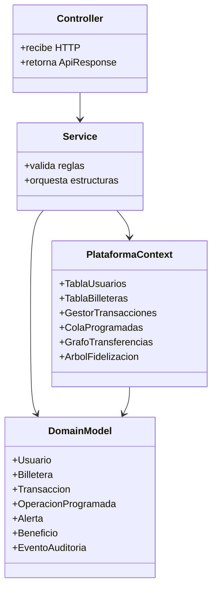

<div align="center">

```
███████╗██╗██████╗ ██╗      ██████╗  ██████╗    ███████╗ █████╗ ███████╗
╚══███╔╝██║██╔══██╗██║     ██╔═══██╗██╔════╝    ██╔════╝██╔══██╗██╔════╝
  ███╔╝ ██║██████╔╝██║     ██║   ██║██║         ███████╗███████║███████╗
 ███╔╝  ██║██╔═══╝ ██║     ██║   ██║██║         ╚════██║██╔══██║╚════██║
███████╗██║██║     ███████╗╚██████╔╝╚██████╗    ███████║██║  ██║███████║
╚══════╝╚═╝╚═╝     ╚══════╝ ╚═════╝  ╚═════╝    ╚══════╝╚═╝  ╚═╝╚══════╝
```

**Plataforma de Billeteras Digitales**


*Proyecto académico · Estructuras de Datos · 2026*

---

**Presentado por**

👤 Juan Esteban Galeano &nbsp;&nbsp;·&nbsp;&nbsp; 👤 Juan Steban Acosta

</div>

---

## ¿Qué es ZIPLOC SAS?

ZIPLOC SAS es una **plataforma completa de billeteras digitales** construida como proyecto académico para demostrar el uso correcto y eficiente de estructuras de datos implementadas desde cero. El backend está hecho en **Spring Boot** con persistencia en **MongoDB**, y el frontend en **React + Vite**.

El proyecto combina estructuras de datos propias en memoria con persistencia documental en MongoDB. Las estructuras permiten demostrar las operaciones algorítmicas y MongoDB conserva la información necesaria para recuperar el estado después de reiniciar el servidor.

```
  Usuario  ──▶  Frontend React  ──▶  API REST Spring Boot  ──▶  Estructuras en Memoria
                                                            └──▶  MongoDB (persistencia)
```

---

## Tabla de contenido

1. [Stack tecnológico](#stack-tecnológico)
2. [Arquitectura](#arquitectura)
3. [Estructuras de datos aplicadas](#estructuras-de-datos-aplicadas)
4. [Módulos del proyecto](#módulos-del-proyecto)
5. [Endpoints de la API](#endpoints-de-la-api)
6. [Guía rápida de uso](#guía-rápida-de-uso)
7. [Ejecutar el proyecto](#ejecutar-el-proyecto)
8. [Pruebas y validación](#pruebas-y-validación)
9. [Cambios funcionales incorporados](#cambios-funcionales-incorporados)

---

## Stack tecnológico

| Capa | Tecnología |
|---|---|
| Backend | Java 21 · Spring Boot 4.0.5 · Maven Wrapper |
| Base de datos | MongoDB |
| Frontend | React 18 · Vite · Tailwind CSS |
| HTTP Client | Axios |
| Estructuras | Implementaciones propias (sin librerías externas) |

---

## Arquitectura

La aplicación sigue una **arquitectura por capas** diseñada para mantener separadas las responsabilidades y facilitar la demostración de cada estructura de datos.

```
HTTP Request
     │
     ▼
┌─────────────────┐
│   Controller    │  Recibe HTTP · Retorna ApiResponse
└────────┬────────┘
         │
         ▼
┌─────────────────┐
│    Service      │  Valida reglas · Orquesta estructuras
└────────┬────────┘
         │
   ┌─────┴──────┐
   ▼            ▼
┌──────────────────────┐     ┌─────────────────┐
│  PlataformaContext   │────▶│   DomainModel   │
│                      │     │                 │
│  TablaUsuarios       │     │  Usuario        │
│  TablaBilleteras     │     │  Billetera      │
│  GestorTransacciones │     │  Transaccion    │
│  ColaProgramadas     │     │  OperacionProg. │
│  GrafoTransferencias │     │  Alerta         │
│  ArbolFidelizacion   │     │  Beneficio      │
└──────────────────────┘     │  EventoAuditoria│
         │                   └─────────────────┘
         ▼
┌─────────────────┐
│    MongoDB      │  Persistencia entre reinicios
└─────────────────┘
```

### Diagrama de clases



### Flujo de una transferencia

```
Cliente
  │
  │  POST /api/transacciones/transferir
  ▼
TransaccionController
  │
  ▼
TransaccionService
  ├─▶ BilleteraService         → descuenta origen · suma destino
  ├─▶ GestorTransacciones      → registra historial · apila reversión
  ├─▶ GrafoTransferencias      → registra arista ponderada entre usuarios
  ├─▶ SistemaRecompensas       → calcula puntos · actualiza nivel
  ├─▶ ServicioAnalitica        → consolida información para reportes y análisis
  └─▶ NotificacionService      → conserva alerta reciente por usuario
  │
  ▼
ApiResponse { ok, datos, mensaje }
```

### Decisiones de diseño

| Decisión | Justificación |
|---|---|
| Estructuras en memoria | Demostrar complejidades y comportamiento de cada estructura |
| MongoDB | Garantizar durabilidad del estado entre reinicios del servidor |
| `PlataformaContext` centralizado | Evita duplicar estado entre servicios |
| `@Service` de Spring | API REST limpia con inyección de dependencias estándar |
| Excepciones controladas | `ApiExceptionHandler` estandariza todos los errores de negocio |

---

## Estructuras de datos aplicadas

### 📋 Lista enlazada

**Usada en:** historial de transacciones por billetera, beneficios canjeados, operaciones procesadas y reportes por periodo.

**Justificación:** conserva orden cronológico y permite recorrer el historial completo para reportes y filtros.

```
[TX-001] → [TX-002] → [TX-003] → [TX-004]
 más antigua                      más reciente
```

| Operación | Complejidad |
|---|---|
| Insertar al final | O(1) |
| Recorrer historial | O(n) |
| Buscar por ID | O(n) |

---

### 📚 Pila — reversión de transacciones

`GestorTransacciones` mantiene una pila de transacciones reversibles.

**Justificación:** la operación más reciente se revierte en O(1), imitando un historial de deshacer.

```
      ┌──────────┐
 TOP  │  TX-004  │  ◀── revertir() actúa aquí
      ├──────────┤
      │  TX-003  │
      ├──────────┤
      │  TX-002  │
      ├──────────┤
      │  TX-001  │
      └──────────┘
```

---

### 🔄 Cola circular — notificaciones

`ColaNotificaciones` conserva las alertas recientes con capacidad máxima fija.

**Justificación:** limita memoria y descarta automáticamente la alerta más antigua cuando la cola está llena.

```
Capacidad = 5 · al insertar A6:
[A1][A2][A3][A4][A5]  →  [A2][A3][A4][A5][A6]
 ↑ descartado
```

---

### ⚡ Cola de prioridad — operaciones programadas

`ColaProgramadas` implementa un heap mínimo por fecha de ejecución y prioridad.

**Justificación:** siempre procesa la operación más urgente sin ordenar toda la cola en cada inserción.

```
         [08:00 · prio 1]   ◀── próxima
        /                 \
 [09:00 · prio 2]   [10:30 · prio 1]
       /
[12:00 · prio 3]
```

| Operación | Complejidad |
|---|---|
| Insertar | O(log n) |
| Extraer más urgente | O(log n) |
| Consultar más urgente | O(1) |

---

### 🌳 Árbol AVL — fidelización

La versión actual sustituyó el BST inicial por un AVL balanceado. `ArbolFidelizacion` organiza usuarios por puntos acumulados mediante un AVL balanceado, desempata por ID y mantiene un índice hash auxiliar para localizar usuarios directamente por identificador.

**Justificación:** facilita rankings, recorridos ordenados y búsquedas por rango. Las inserciones, actualizaciones y eliminaciones mantienen el balance mediante rotaciones LL, RR, LR y RL.

```
              [Usuario C · 850 pts]
             /                     \
  [Usuario A · 420 pts]    [Usuario E · 1200 pts]
         \                         /
  [Usuario B · 610 pts]  [Usuario D · 990 pts]
```

---

### #️⃣ Tablas hash — usuarios y billeteras

| Estructura | Estrategia de colisión | Uso |
|---|---|---|
| `TablaUsuarios` | Encadenamiento separado | Búsqueda por ID de usuario |
| `TablaBilleteras` | Sondeo lineal | Consulta de saldo y actualizaciones |

```
TablaUsuarios (encadenamiento):        TablaBilleteras (sondeo lineal):
┌───┬─────────────────┐               ┌───┬──────────┐
│ 0 │ → [U-A] → [U-G] │               │ 0 │ [B-004]  │
│ 1 │ → [U-B]         │               │ 1 │ vacío    │
│ 2 │ vacío           │               │ 2 │ [B-001]  │
│ 3 │ → [U-C] → [U-F] │               │ 3 │ [B-007]  │
└───┴─────────────────┘               └───┴──────────┘
```

---

### 🕸️ Grafo — red de transferencias

`GrafoTransferencias` representa movimientos entre usuarios como aristas dirigidas y ponderadas por monto.

**Justificación:** permite analizar vecinos, montos, conexiones, ciclos y patrones de relación financiera.

```
  [Usuario A] ──$50.000──▶ [Usuario B]
       │                        │
  $20.000                   $80.000
       ▼                        ▼
  [Usuario C] ◀─$15.000── [Usuario D]
```

**Consultas disponibles:** vecinos directos · monto total entre nodos · detección de ciclos · usuarios más conectados

Además, `PlataformaContext` mantiene una segunda instancia de `GrafoTransferencias` para representar movimientos entre billeteras. Este grafo es independiente del que relaciona usuarios y se consulta mediante `/api/analitica/grafo-billeteras`.


---

### 🔢 Estructuras ordenadas

`GestorTransacciones.obtenerMayoresValores` ordena el historial por valor para consultar las transacciones más altas, cubriendo el requisito de extraer operaciones de mayor valor.

---

## Módulos del proyecto

### Backend — Spring Boot

```
src/main/java/ZiplocSAS/
├── api/
│   ├── config/
│   │   ├── CorsConfig.java          # CORS para el frontend
│   │   └── package-info.java
│   ├── controller/                  # Endpoints REST
│   └── dto/                         # Objetos de entrada/salida
├── application/
│   └── service/                     # Reglas de negocio
├── domain/
│   ├── enums/                       # TipoTransaccion, EstadoTransaccion, etc.
│   ├── model/                       # Entidades de dominio
│   └── structures/                  # Lista · Pila · Colas · Árbol · Hash · Grafo
├── infrastructure/
│   ├── persistence/                 # Documentos MongoDB
│   ├── repository/                  # Spring Data repositories
│   └── scheduler/                   # Procesamiento automático de ColaProgramadas
└── ProyectoFinalApplication.java
```

### Frontend — React + Vite

```
ziplocSAS_Front/src/
├── api/                # Axios y tratamiento de errores
├── auth/               # Contexto, almacenamiento y servicio de autenticación
├── components/         # Componentes reutilizables de la interfaz
├── hooks/              # Hooks de usuarios, billeteras, transacciones,
│                       # operaciones programadas, recompensas, analítica y alertas
├── pages/              # Login, Dashboard, Usuarios, Billeteras,
│                       # Transacciones, OperacionesProgramadas,
│                       # Recompensas, Notificaciones y Analítica
├── services/           # Servicios HTTP de la aplicación
├── App.jsx             # Enrutamiento principal
└── main.jsx            # Punto de entrada
```

### Enumeraciones del dominio

| Enum | Valores |
|---|---|
| `TipoTransaccion` | `RECARGA` · `RETIRO` · `TRANSFERENCIA` · `PAGO_PROGRAMADO` |
| `EstadoTransaccion` | `COMPLETADA` · `PENDIENTE` · `FALLIDA` · `PROCESANDO` |
| `NivelUsuario` | `BRONCE` · `PLATA` · `ORO` · `PLATINO` |
| `TipoBilletera` | `AHORRO` · `CORRIENTE` · `INVERSION` |

---

## Endpoints de la API

> **Base URL:** `http://localhost:8080/api`  
> Las rutas siguientes corresponden a los mappings de los controladores del proyecto.

### Usuarios — `/usuarios`

| Método | Ruta | Descripción |
|---|---|---|
| `POST` | `/usuarios` | Registrar usuario |
| `POST` | `/usuarios/login` | Autenticar usuario |
| `GET` | `/usuarios` | Listar usuarios |
| `GET` | `/usuarios/{id}` | Consultar usuario por ID |
| `PATCH` | `/usuarios/{id}/activo?activo=true` | Activar o desactivar usuario |
| `GET` | `/usuarios/puntos/rango?min={min}&max={max}` | Buscar usuarios por rango de puntos mediante el AVL |
| `GET` | `/usuarios/top-puntos?limite={n}` | Consultar los usuarios con más puntos |
| `PUT` | `/usuarios/{id}` | Actualizar usuario |
| `DELETE` | `/usuarios/{id}` | Eliminar usuario |

### Billeteras — `/billeteras`

| Método | Ruta | Descripción |
|---|---|---|
| `POST` | `/billeteras` | Crear billetera |
| `GET` | `/billeteras` | Listar billeteras |
| `GET` | `/billeteras/{id}` | Consultar billetera |
| `GET` | `/billeteras/usuario/{usuarioId}` | Listar billeteras de un usuario |
| `GET` | `/billeteras/{id}/saldo` | Consultar saldo |
| `PUT` | `/billeteras/{id}` | Actualizar billetera |
| `DELETE` | `/billeteras/{id}` | Eliminar billetera |

### Transacciones — `/transacciones`

| Método | Ruta | Descripción |
|---|---|---|
| `POST` | `/transacciones` | Registrar transacción según el DTO |
| `POST` | `/transacciones/recargar` | Recargar saldo |
| `POST` | `/transacciones/retirar` | Retirar saldo |
| `POST` | `/transacciones/transferir` | Transferir entre billeteras |
| `GET` | `/transacciones/{id}` | Consultar transacción |
| `GET` | `/transacciones/billetera/{billeteraId}` | Consultar transacciones de una billetera |
| `GET` | `/transacciones/mayor-valor` | Consultar transacciones de mayor valor |
| `GET` | `/transacciones/integridad` | Ejecutar verificación recursiva del historial |
| `POST` | `/transacciones/{id}/revertir` | Revertir una transacción |
| `POST` | `/transacciones/revertir-ultima` | Revertir la última transacción registrada en la pila |

### Operaciones programadas — `/programadas`

| Método | Ruta | Descripción |
|---|---|---|
| `POST` | `/programadas` | Crear operación programada |
| `GET` | `/programadas?usuarioId={id}` | Listar operaciones pendientes; `usuarioId` es opcional |
| `GET` | `/programadas/procesadas?usuarioId={id}` | Listar operaciones procesadas; `usuarioId` es opcional |
| `POST` | `/programadas/procesar?usuarioId={id}` | Procesar operaciones vencidas; admite `usuarioId` y fecha `hasta` opcionales |

El procesamiento automático también está coordinado por `OperacionProgramadaScheduler`.

### Recompensas — `/recompensas`

| Método | Ruta | Descripción |
|---|---|---|
| `GET` | `/recompensas/beneficios` | Listar beneficios disponibles |
| `GET` | `/recompensas/{usuarioId}/puntos` | Consultar puntos del usuario |
| `GET` | `/recompensas/{usuarioId}/nivel` | Consultar nivel del usuario |
| `POST` | `/recompensas/{usuarioId}/canjear/{beneficioId}` | Canjear un beneficio |

### Notificaciones — `/notificaciones`

| Método | Ruta | Descripción |
|---|---|---|
| `GET` | `/notificaciones/{usuarioId}` | Consultar notificaciones del usuario |
| `POST` | `/notificaciones/{usuarioId}/despachar` | Despachar una notificación |
| `PUT` | `/notificaciones/{usuarioId}/{alertaId}/leer` | Marcar una notificación como leída |

### Analítica — `/analitica`

| Método | Ruta | Descripción |
|---|---|---|
| `GET` | `/analitica/reporte/{usuarioId}` | Obtener reporte del usuario |
| `GET` | `/analitica/top-billeteras` | Consultar billeteras con mayor volumen |
| `GET` | `/analitica/usuarios-activos` | Consultar usuarios más activos |
| `GET` | `/analitica/auditoria/{usuarioId}` | Consultar eventos de auditoría |
| `GET` | `/analitica/frecuencia-tipos` | Consultar frecuencia por tipo de transacción |
| `GET` | `/analitica/categorias-activas` | Consultar categorías activas |
| `GET` | `/analitica/patrones-gasto` | Resumir egresos según tipo de billetera de origen |
| `GET` | `/analitica/monto-total` | Consultar monto total |
| `GET` | `/analitica/grafo/{usuarioId}` | Consultar grafo de transferencias entre usuarios |
| `GET` | `/analitica/grafo-billeteras` | Consultar grafo de movimientos entre billeteras |
| `GET` | `/analitica/transacciones-mayor-valor` | Consultar transacciones de mayor valor |
| `GET` | `/analitica/rendimiento/{usuarioId}` | Consultar métricas de rendimiento |

---

## Guía rápida de uso

### Crear usuario
```http
POST /api/usuarios
Content-Type: application/json

{
  "nombre": "Laura Gomez",
  "email": "laura@example.com",
  "contrasena": "secreto123",
  "telefono": "3001234567"
}
```

### Login
```http
POST /api/usuarios/login
Content-Type: application/json

{
  "email": "laura@example.com",
  "contrasena": "secreto123"
}
```

### Crear billetera
```http
POST /api/billeteras
Content-Type: application/json

{
  "nombre": "Ahorro",
  "tipo": "AHORRO",
  "saldo": 50000,
  "usuarioId": "USR-abc123"
}
```

### Transferir
```http
POST /api/transacciones/transferir
Content-Type: application/json

{
  "valor": 10000,
  "billeteraOrigenId": "BIL-origen",
  "billeteraDestinoId": "BIL-destino"
}
```

> La transferencia actualiza automáticamente el grafo, los puntos de fidelización y genera una notificación.

### Programar operación
```http
POST /api/programadas
Content-Type: application/json

{
  "fechaEjecucion": "2026-06-01T08:00:00",
  "tipo": "PAGO_PROGRAMADO",
  "valor": 15000,
  "billeteraOrigenId": "BIL-origen",
  "billeteraDestinoId": "BIL-destino",
  "prioridad": 1,
  "frecuencia": "NINGUNA"
}
```

### Funcionamiento actualizado de las operaciones programadas

- El heap mínimo se reconstruye desde MongoDB antes de procesar cada lote, por lo que el procesamiento no depende únicamente de los datos que quedaron en memoria.
- Las operaciones pueden configurarse con recurrencia `NINGUNA`, `DIARIA`, `SEMANAL` o `MENSUAL`.
- Las operaciones fallidas permanecen pendientes y almacenan el detalle en `ultimoError`, que también se presenta en la interfaz.
- Cada transacción originada por una operación programada conserva `operacionProgramadaId` para reconocer reintentos y evitar duplicar movimientos ya persistidos.
- Las consultas y el procesamiento manual pueden filtrarse por `usuarioId`; el scheduler automático procesa las cuentas.
- El servicio valida el monto, la fecha, el tipo de operación y las billeteras requeridas.

### Revertir transacción
```http
POST /api/transacciones/{id}/revertir
```

### Funcionalidades incorporadas en integridad y analítica

**Verificación recursiva:** `GET /api/transacciones/integridad` revisa los identificadores, fechas, tipos, estados, montos, puntos y referencias de billeteras del historial. El recorrido se realiza de forma recursiva por división del historial para controlar la profundidad de las llamadas.

**Patrones de gasto:** `GET /api/analitica/patrones-gasto` agrupa los egresos según el tipo de billetera de origen. Esta clasificación utiliza el dato disponible en el modelo; no representa categorías comerciales como alimentación o transporte.

**Grafo de billeteras:** además del grafo de transferencias entre usuarios, el sistema mantiene un grafo dirigido y ponderado para movimientos entre billeteras. MongoDB permite reconstruir ambos grafos al iniciar la aplicación. Las transacciones revertidas se excluyen de la reconstrucción y, al revertir una transacción, se actualizan los grafos para retirar su relación del análisis.

### Consultar analítica
```http
GET /api/analitica/grafo/{usuarioId}
GET /api/analitica/reporte/{usuarioId}
GET /api/analitica/auditoria/{usuarioId}
```

---

## Ejecutar el proyecto

### Requisitos previos

- JDK 21 (la versión declarada en `pom.xml`)
- Node.js 18+
- MongoDB corriendo en `localhost:27017`

### Backend

```powershell
cmd /c mvnw.cmd spring-boot:run
```

El servidor arranca en → `http://localhost:8080`

### Frontend

```bash
cd ziplocSAS_Front
npm install
npm run dev
```

El cliente arranca en → `http://localhost:5173`

### Ejecutar pruebas

```powershell
cmd /c mvnw.cmd test
```

---

## Resumen de estructuras

| Estructura | Clase | Complejidad clave |
|---|---|---|
| Lista enlazada | `ListaEnlazada<T>` | Inserción O(1) · Búsqueda O(n) |
| Pila | `PilaReversion` | Push/Pop O(1) |
| Cola circular | `ColaCircular<T>` | Inserción O(1) · Descarte O(1) |
| Heap mínimo | `ColaProgramadas` | Inserción O(log n) · Extracción O(log n) |
| Árbol AVL | `ArbolFidelizacion` | Búsqueda/actualización O(log n); índice por ID O(1) promedio |
| Hash encadenamiento | `TablaUsuarios` | Búsqueda O(1) promedio |
| Hash sondeo lineal | `TablaBilleteras` | Búsqueda O(1) promedio |
| Grafo dirigido ponderado | `GrafoTransferencias` | Vecinos O(grado del nodo) |

---

<div align="center">

Hecho con ☕ y muchas estructuras de datos

**Juan Esteban Galeano** · **Juan Steban Acosta**

*Estructuras de Datos · 2026*

</div>


## Pruebas y validación

El proyecto incluye pruebas para el servicio de usuarios, el árbol de fidelización y los flujos de la plataforma. Además, durante las modificaciones se realizaron verificaciones aisladas de las estructuras y revisiones de sintaxis del frontend.

### Verificaciones realizadas durante los cambios

- AVL: inserción ordenada, actualización de usuarios, consulta por rango, ranking y eliminación.
- Heap mínimo: ordenamiento por fecha de ejecución y prioridad.
- Frontend: análisis sintáctico de los componentes JSX modificados y `node --check` de los módulos JavaScript revisados.

**Estado de la validación integral:** no se pudo completar la ejecución de `mvnw test` en el entorno donde se aplicaron los cambios porque Maven Wrapper no logró descargar Maven desde Maven Central. Por esta razón, no se afirma que la compilación completa ni todas las pruebas Spring/MongoDB hayan finalizado correctamente. Es necesario ejecutar las verificaciones en el equipo local.

### Comandos de verificación

Backend, desde la raíz del proyecto:

```powershell
.\mvnw.cmd test
```

Si PowerShell bloquea la ejecución:

```powershell
cmd /c mvnw.cmd test
```

Frontend:

```bash
cd ziplocSAS_Front
npm install
npm run build
npm run dev
```

La conexión a MongoDB debe estar disponible antes de iniciar Spring Boot.

## Cambios funcionales incorporados

Esta versión del README integra las modificaciones aplicadas al proyecto:

1. **Fidelización con AVL:** se reemplazó el árbol BST sin balanceo por un AVL con rotaciones LL, RR, LR y RL. El orden se establece por puntos acumulados y, en caso de empate, por ID. Se añadió un índice hash auxiliar para búsquedas por identificador. Los rankings y las consultas por rango utilizan el AVL.
2. **Operaciones programadas persistentes:** el heap se reconstruye desde MongoDB antes de cada lote; se conserva el detalle de errores; las operaciones fallidas pueden volver a intentarse; y se añadió el identificador `operacionProgramadaId` para controlar duplicados.
3. **Recurrencia:** las operaciones admiten `NINGUNA`, `DIARIA`, `SEMANAL` y `MENSUAL`.
4. **Filtro por usuario:** las consultas y el procesamiento manual de operaciones programadas pueden limitarse al usuario correspondiente; el scheduler automático atiende todas las cuentas.
5. **Integridad recursiva:** se incorporó el endpoint `/api/transacciones/integridad` para revisar la consistencia del historial.
6. **Analítica de gasto:** se añadió `/api/analitica/patrones-gasto`, que agrupa egresos por tipo de billetera de origen.
7. **Grafo de billeteras:** se incorporó un segundo grafo ponderado, independiente del grafo entre usuarios, y su endpoint `/api/analitica/grafo-billeteras`.
8. **Reconstrucción de grafos:** los grafos se reconstruyen desde los datos persistidos al iniciar la aplicación y se actualizan al revertir transacciones.
9. **Registro y mensajes de error:** `UsuarioDTO.activo` utiliza `Boolean` para admitir valores nulos durante la deserialización; el interceptor HTTP del frontend prioriza los detalles devueltos por el backend (`error` o `detail`) antes de mostrar un mensaje genérico.

---

<div align="center">

**ZIPLOC SAS · Estructuras de Datos · 2026**

</div>
